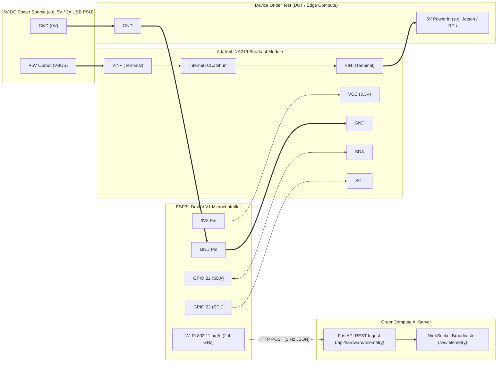
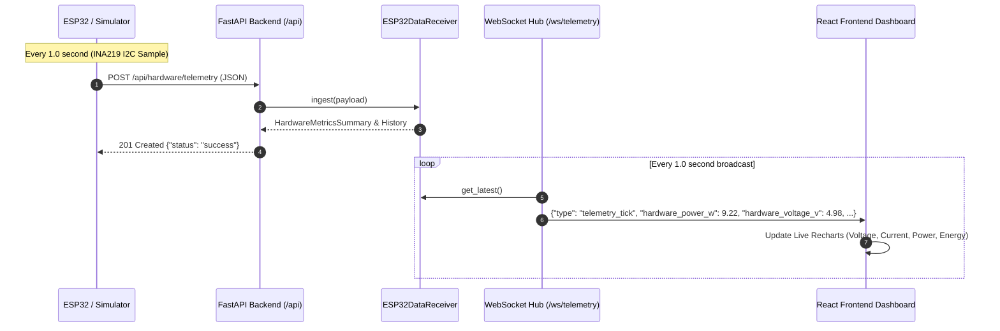

# GreenCompute AI — Edge Hardware & ESP32 Telemetry Subsystem

> **High-Precision Physical Current, Voltage, Power & Energy Telemetry for Sustainable Edge AI Systems**  
> *Department: [SPEC_ENG] Specialized Engineering / IoT Telemetry Architecture*

---

## 1. System Overview

GreenCompute AI pairs real-time software-level energy profiling (CodeCarbon, NVML, psutil) with **physical ground-truth hardware power telemetry**. 

Physical telemetry eliminates hypervisor abstraction penalties and captures actual electrical draw—including voltage regulator losses, power rails, thermal throttling currents, and edge device idle states.

The hardware subsystem comprises two complementary implementations:
1. **Physical Microcontroller Node**: An **ESP32 DevKit V1** paired with an **Adafruit INA219** I2C high-side current and voltage sensor breakout, measuring live DC current into edge accelerators (Raspberry Pi 4/5, NVIDIA Jetson Nano/Orin, Coral Edge TPU, or USB compute dongles).
2. **Realistic Software Simulator (`hardware/simulator.py`)**: A Python-based hardware emulation engine providing identical electrical telemetry schemas, bus voltage sag under load, ADC quantization noise, and AI inference burst modeling for mock environments, automated tests, and judge demonstrations without requiring physical hardware connected.

---

## 2. Electrical Specifications & Measurement Theory

### INA219 Sensor Specifications
| Parameter | Value | Notes |
| :--- | :--- | :--- |
| **Monitored Bus Voltage Range** | `0V` to `+26V DC` | Suitable for 3.3V, 5.0V, 12.0V, 19.0V, and 24.0V DC rails |
| **Supply Voltage ($V_{CC}$)** | `3.0V` to `5.5V DC` | Powered from ESP32 `3V3` pin |
| **I2C Address** | `0x40` (default) | Configurable via solder jumpers `A0`/`A1` up to `0x4F` |
| **I2C Clock Speed** | Standard (100 kHz) / Fast (400 kHz) | Supported by ESP32 Wire library |
| **Current Shunt Resistor** | $0.100\ \Omega$ ($100\text{ m}\Omega$), $1\%$ precision | Standard 2W SMD resistor on breakout |
| **Max Continuous Current** | $\pm 3.2\text{ A}$ | With default $0.1\ \Omega$ shunt ($V_{\text{shunt\_max}} = \pm 320\text{ mV}$) |
| **Current Resolution** | $0.8\text{ mA}$ LSB | Internal 12-bit delta-sigma ADC with 128-sample averaging |
| **Bus Voltage Resolution** | $4\text{ mV}$ LSB | Internal voltage divider |

### High-Side Sensing Principle & Calculations

The INA219 is configured as a **high-side current sensor**, placed between the positive terminal of the DC power supply ($V_{\text{BUS+}}$) and the positive supply pin of the Device Under Test (DUT).

```
   [+5V DC Power Source]
            │
            ▼
        [ VIN+ ]
        ┌──────┐
        │ R_sh │  <--- 0.100 Ohm Precision Shunt
        └──────┘
        [ VIN- ]
            │
            ▼
   [+5V DUT / Edge Accelerator (Jetson / RPi)]
            │
            ▼
     [ Common GND ]
```

1. **Shunt Voltage Drop ($V_{\text{shunt}}$)**:
   $$V_{\text{shunt}} = V_{\text{IN+}} - V_{\text{IN-}} = I_{\text{load}} \times R_{\text{shunt}}$$
   For example, an edge model drawing $1500\text{ mA}$ causes:
   $$V_{\text{shunt}} = 1.500\text{ A} \times 0.100\ \Omega = 0.150\text{ V} = 150.0\text{ mV}$$

2. **Total Bus Voltage ($V_{\text{bus}}$)**:
   $$V_{\text{bus}} = V_{\text{IN-}} + V_{\text{shunt}}$$

3. **Instantaneous Power ($P$)**:
   $$P = V_{\text{bus}} \times I_{\text{load}} \quad \text{[Watts]}$$

4. **Discrete Energy Accumulation ($E$)**:
   The ESP32 firmware and Python simulator integrate power samples over time using trapezoidal/Riemann integration:
   $$E_{t} = E_{t-1} + \frac{P_{t} \times \Delta t}{3600} \quad \text{[Watt-hours (Wh)]}$$
   $$\text{Energy in milliWatt-hours (mWh)} = E_{\text{Wh}} \times 1000$$

---

## 3. Hardware Pinout & Wiring Diagram

### ESP32 DevKit V1 to INA219 Pinout

| ESP32 DevKit V1 Pin | INA219 Breakout Pin | Wire Color (Recommended) | Description |
| :--- | :--- | :--- | :--- |
| **`3V3`** | **`VCC`** | Red | 3.3V Logic & ADC Power Supply |
| **`GND`** | **`GND`** | Black | System Common Ground |
| **`GPIO 21` (D21)** | **`SDA`** | Blue / Green | I2C Data Line (ESP32 hardware default) |
| **`GPIO 22` (D22)** | **`SCL`** | Yellow / White | I2C Clock Line (ESP32 hardware default) |

### INA219 to DC Load (5V VBUS Rail)

| INA219 Screw Terminal | Connection Target | Functional Role |
| :--- | :--- | :--- |
| **`VIN+`** | `+5V` Positive Lead from 5V Power Supply / USB Host | High-side power input from supply |
| **`VIN-`** | `+5V` Power Input of Edge Device / DUT | High-side power output to device load |
| **`GND`** | Ground Lead of Power Supply & Ground of DUT | All grounds MUST be tied together (Common Ground) |

### Complete Circuit Schematic (Mermaid)



### ASCII Wiring Guide

```
  +─────────────────────────────────────────────────────────────+
  │                      ESP32 DevKit V1                        │
  │                                                             │
  │   [3V3] ──(Red Wire)──────────────> [VCC] INA219 Breakout   │
  │   [GND] ──(Black Wire)────────────> [GND] INA219 Breakout   │
  │   [D21] ──(Blue Wire)───[SDA]─────> [SDA] INA219 Breakout   │
  │   [D22] ──(Yellow Wire)─[SCL]─────> [SCL] INA219 Breakout   │
  +─────────────────────────────────────────────────────────────+

  +─────────────────────────────────────────────────────────────+
  │                   High-Side DC Power Path                   │
  │                                                             │
  │  [5V DC PSU +5V] ──> [VIN+] INA219 [VIN-] ──> [DUT +5V In]  │
  │                                                             │
  │  [5V DC PSU GND] ───────────────────────────> [DUT GND]     │
  │         │                                                   │
  │         └───────────────────────────────────> [ESP32 GND]   │
  +─────────────────────────────────────────────────────────────+
```

---

## 4. Rigorous Safety & Electrical Guidelines

> [!CAUTION]
> **STRICT SAFETY INVARIANT — LOW VOLTAGE DC ONLY (MAX 26V DC):**
> * This circuit is strictly engineered for **low-voltage direct current (DC)** circuits (nominal 5V DC, absolute maximum 26V DC).
> * **NEVER connect any part of the ESP32, INA219, or breadboard directly to AC mains power (110V/120V/220V/240V AC).** Connecting AC mains to the INA219 or microcontroller will cause instantaneous catastrophic component failure, violent arc flashes, risk of explosion, fire, and fatal electric shock.

### Mandatory Operational Safeguards
1. **Common Ground Integrity**: Ensure the power supply negative lead, load ground, and ESP32 GND share a solid common reference. Floating grounds will induce incorrect ADC offset readings or ground loop oscillations.
2. **Current Rating Overhead**: The default $0.100\ \Omega$ shunt on standard breakouts is rated for $2\text{ W}$, translating to a maximum continuous current of $\approx 3.2\text{ A}$. For loads exceeding $3.0\text{ A}$, ensure adequate airflow or swap the shunt for a higher wattage component ($0.05\ \Omega$ or $0.025\ \Omega$).
3. **Inline Fuse Protection**: Always place a fast-acting **3A or 5A automotive blade fuse** or PTC resettable fuse immediately downstream of the 5V DC power source.
4. **Logic Level Isolation**: The INA219 VCC pin must be connected to ESP32 **3V3** (not 5V). Supplying 5V to INA219 VCC pulls I2C bus levels to 5V, which can exceed the absolute maximum GPIO input rating of the ESP32 ($3.6\text{ V}$).

---

## 5. Firmware Flashing Guide

The ESP32 firmware source is located in `hardware/esp32/sensor_firmware/`.

### Method A: Flashing via PlatformIO (Recommended)

PlatformIO handles library dependencies and compiler toolchains automatically.

1. **Install PlatformIO Core** (if not already installed):
   ```bash
   pip install -U platformio
   ```
2. **Navigate to the firmware directory**:
   ```bash
   cd hardware/esp32/sensor_firmware
   ```
3. **Configure Wi-Fi and Backend IP**:
   Open `main.ino` and update your Wi-Fi credentials and server address:
   ```cpp
   const char* WIFI_SSID     = "Your_WiFi_Network";
   const char* WIFI_PASSWORD = "Your_WiFi_Password";
   const char* BACKEND_URL   = "http://192.168.1.100:8000/api/hardware/telemetry";
   ```
4. **Connect the ESP32 via Micro-USB** to your workstation.
5. **Build and Upload**:
   ```bash
   pio run --target upload
   ```
6. **Launch Serial Monitor**:
   ```bash
   pio device monitor -b 115200
   ```

### Method B: Flashing via Arduino IDE 2.x

1. **Install Arduino IDE**: Download from [arduino.cc](https://www.arduino.cc/en/software).
2. **Add ESP32 Board URL**:
   - Go to `File` → `Preferences` → `Additional Boards Manager URLs`.
   - Add: `https://raw.githubusercontent.com/espressif/arduino-esp32/gh-pages/package_esp32_index.json`
3. **Install ESP32 Board Package**:
   - Go to `Tools` → `Board` → `Boards Manager...`
   - Search for **`esp32`** by Espressif Systems and click **Install**.
4. **Install Required Libraries**:
   - Go to `Tools` → `Manage Libraries...`
   - Search and install:
     * **Adafruit INA219** (v1.2.1+)
     * **Adafruit BusIO** (v1.14.5+)
5. **Open Project**: Open `hardware/esp32/sensor_firmware/main.ino`.
6. **Select Board & Port**:
   - Board: `DOIT ESP32 DEVKIT V1` (or `ESP32 Dev Module`)
   - Port: Select your device COM port (e.g., `COM3` on Windows, `/dev/ttyUSB0` on Linux)
7. **Upload Firmware**: Click the **Upload** arrow button ($\rightarrow$).
8. **Verify Serial Output**: Open Serial Monitor at **115200 baud**.

---

## 6. Python Telemetry Simulator (`simulator.py`)

When physical hardware is unavailable or during automated CI/CD and judge presentations, the **GreenCompute Hardware Simulator** emulates physical ESP32 and INA219 behavior with realistic physics models.

### Simulator Capabilities
* **Electrical Physics Engine**: Simulates internal wire resistance ($R_{\text{wire}} = 0.04\ \Omega$), high-side shunt resistance ($R_{\text{shunt}} = 0.10\ \Omega$), bus voltage sag under load, and Gaussian ADC quantization noise.
* **Workload-Induced Spikes (`--spike-on-workload`)**: Emulates dynamic inference cycles, switching between low idle power (100–250 mA, ~0.8W) and heavy AI inference load (1800–2500 mA, ~11.5W).
* **Dual Transport**: HTTP POST (standard REST ingest) and real-time WebSocket client streaming.
* **Offline Resiliency**: If the backend is temporarily offline, the simulator logs clear warnings, maintains continuous Riemann energy accumulation, and seamlessly reconnects without crashing.

### CLI Reference

```
python hardware/simulator.py [OPTIONS]
```

| Flag | Type | Default | Description |
| :--- | :--- | :--- | :--- |
| `--interval` | `float` | `1.0` | Sampling and transmission frequency in seconds. |
| `--backend-url` | `str` | `http://localhost:8000` | Target GreenCompute AI backend base URL. |
| `--endpoint` | `str` | `/api/hardware/telemetry` | POST telemetry route on backend. |
| `--device-id` | `str` | `esp32_ina219_node1` | Unique sensor device identifier string. |
| `--spike-on-workload` | `flag` | `False` | Toggles dynamic workload burst simulation (160mA idle $\leftrightarrow$ 2400mA peak). |
| `--burst-interval` | `float` | `8.0` | Duration in seconds of idle load between inference bursts. |
| `--burst-duration` | `float` | `3.0` | Duration in seconds of peak inference spike. |
| `--ws-mode` | `flag` | `False` | Stream via WebSocket instead of HTTP POST. |
| `--ws-url` | `str` | `ws://localhost:8000/ws/telemetry` | WebSocket server URL when in `--ws-mode`. |
| `-n`, `--count` | `int` | `0` | Number of samples to emit before stopping (`0` = infinite). |
| `--quiet` | `flag` | `False` | Suppresses per-second console metric logs. |
| `--json-output` | `flag` | `False` | Streams raw JSON strings to standard output (for Unix pipes). |

### Example Run Commands

#### 1. Standard Live Telemetry Ingest (Mock Hardware Demo)
```bash
python hardware/simulator.py --spike-on-workload --interval 1.0
```

*Terminal Output:*
```text
12:53:39 [INFO] Starting ESP32 INA219 Simulator for [esp32_ina219_node1]
12:53:39 [INFO] Reporting to: http://localhost:8000/api/hardware/telemetry every 1.00s
12:53:39 [INFO] Workload spikes ENABLED: cycle every 8.0s for 3.0s peak.
[ESP32+INA219] #1    | V: 5.007 V | I:  159.46 mA | P:  0.798 W | E:  0.0000 Wh |  [IDLE/NOMINAL] | HTTP 201
[ESP32+INA219] #2    | V: 4.902 V | I: 2349.62 mA | P: 11.518 W | E:  0.0260 Wh | [WORKLOAD PEAK] | HTTP 201
[ESP32+INA219] #3    | V: 5.002 V | I:  202.43 mA | P:  1.012 W | E:  0.0283 Wh |  [IDLE/NOMINAL] | HTTP 201
```

#### 2. Send Fixed Number of Samples for CI / Unit Testing
```bash
python hardware/simulator.py --count 10 --interval 0.5
```

#### 3. Stream Telemetry Directly Over WebSocket
```bash
python hardware/simulator.py --ws-mode --ws-url ws://localhost:8000/ws/telemetry
```

#### 4. JSON Pipeline Streaming to Tools / Files
```bash
python hardware/simulator.py --json-output --count 5 > telemetry_dump.jsonl
```

---

## 7. Telemetry Data Schemas

The telemetry packet emitted by both the physical ESP32 and the simulator follows an augmented dual-compatible JSON schema:

```json
{
  "device_id": "esp32_ina219_node1",
  "timestamp": "2026-11-13T07:23:40.128452Z",
  "voltage_v": 4.982,
  "current_ma": 1850.45,
  "power_w": 9.218,
  "energy_wh": 0.04285,
  "shunt_voltage_mv": 185.045,
  "power_mw": 9218.0,
  "energy_mwh": 42.85,
  "voltage": 4.982,
  "current": 1.8505,
  "power": 9.218,
  "energy": 0.04285,
  "sample_index": 42,
  "workload_spike": true
}
```

* **`voltage_v`**: Measured bus voltage in Volts ($V$).
* **`current_ma`**: Measured load current in Milliamperes ($mA$).
* **`power_w`**: Instantaneous power in Watts ($W$).
* **`energy_wh`**: Cumulative energy consumed since boot in Watt-hours ($Wh$).
* **`shunt_voltage_mv`**: Voltage drop across the $0.1\ \Omega$ shunt in Millivolts ($mV$).
* **`power_mw`**: Power in Milliwatts ($mW$).
* **`energy_mwh`**: Cumulative energy in milliWatt-hours ($mWh$).
* **`workload_spike`**: Boolean flag indicating whether high-load inference is actively running.

---

## 8. Integration with GreenCompute Platform



* **Live Dashboard**: The React frontend (`frontend/src/pages/HardwarePage.tsx`) connects to `/ws/telemetry` and displays live charts for bus voltage, shunt current, power draw, and cumulative energy.
* **REST Endpoints**:
  * `POST /api/hardware/telemetry` — Ingest sensor packet.
  * `GET /api/hardware/latest` — Fetch the most recent sensor reading.
  * `GET /api/hardware/summary` — Aggregate metrics (peak power, average power, sample count, total energy).
  * `GET /api/hardware/history?limit=50` — Time-series buffer for charting.
